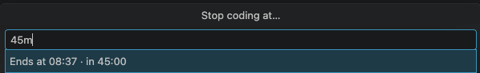
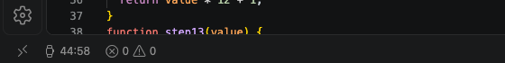
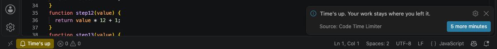

# Code Time Limiter

A countdown in the VS Code status bar that tells you when to stop coding. You set it in one step by typing `45m`, `1h30` or `18:30`. When it reaches zero you get one notice with a «5 more minutes» button, and your editors and files stay as they were.







## Install

```sh
code --install-extension kembec.code-time-limiter
```

Requires VS Code 1.86 or later.

## Set a limit

Click the watch in the status bar, or run **Code Time Limiter: Set a time limit**. Type a duration or an end time; the field shows when the limit ends before you press Enter. The next time you open it, it holds the last value you used.

| You type | The limit ends |
|---|---|
| `45m`, `45`, `90 min`, `30 minutos` | after that many minutes |
| `1h`, `1h30`, `1.5h`, `2 horas`, `2 hours` | after that many hours |
| `18:30` | at that time today, or tomorrow if it has already passed (24-hour clock) |

A limit runs from 1 minute to 24 hours.

## While it runs

- The status bar counts down to the second: `42:09`, or `1:05:00` above an hour. Hover it to see the end time.
- Click it to get **5 more minutes**, **Change the limit** or **Stop the limit**.
- In the last 5 minutes the item switches to the theme's warning color and the status bar says «5 minutes left».
- At zero the item reads **Time's up** and one notification appears with **5 more minutes**. Dismiss it and nothing else happens: no diagnostics are added, and every editor stays open and editable.
- Reloading the window keeps a running limit. A limit that expired while VS Code was not running does not come back.

## Commands and settings

| Command | Title in the Command Palette |
|---|---|
| `codeTimeLimiter.setLimit` | Code Time Limiter: Set a time limit |
| `codeTimeLimiter.addFive` | Code Time Limiter: 5 more minutes (with no limit running, starts one of 5 minutes) |
| `codeTimeLimiter.stop` | Code Time Limiter: Stop the limit |
| `codeTimeLimiter.toggleActivate` | Code Time Limiter: Set or manage the time limit (what the status bar click runs) |

| Setting | Default | Effect |
|---|---|---|
| `codeTimeLimiter.enableAtStartup` | `false` | Asks for a limit when VS Code starts, unless one is already running |

## Languages

Commands, messages and the setting description are in English and Spanish and follow the VS Code display language. The input accepts English and Spanish units in either language.

## Development

```sh
npm ci
npm run test:unit   # input parsing, countdown and translations, with node --test
npm test            # lint, then integration tests in a VS Code that @vscode/test-electron downloads
```

On Linux without a display, run `npm test` under `xvfb-run -a`.

## License

This project is licensed under the [AGPL-3.0](https://opensource.org/licenses/AGPL-3.0). Its use, modification, and distribution are allowed under the terms of this license. The full text is in [LICENSE](LICENSE).
